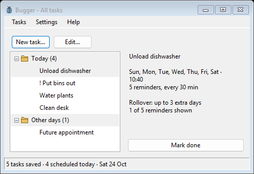
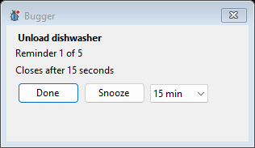

# Bugger

A small Windows app that keeps bugging you until the task is done.

Set a reminder, choose how often it repeats, then mark it done or snooze it. Bugger lives in your tray and keeps unfinished tasks in view.

- Weekly or one-time reminders, with optional daily rollover.
- Important reminders stay open until you act.
- Portable, with your tasks saved locally in a readable CSV file.
- Classic Windows controls, no account or installation required.

## Download

**[Download Bugger for Windows x64](https://github.com/Mofman1/Bugger/releases/latest)**
Other OS? Good luck I'm sure if you care enough you can recompile it its all AI generated anyways.
Choose `Bugger.exe`, save it in a writable folder, and run it. The ZIP also includes instructions and the license. The .NET runtime is included.

Closing the window keeps reminders running in the tray. Use **Exit** to quit. To update, exit Bugger and replace the executable, keeping `tasks.csv` and `settings.txt`.

The executable is unsigned, so Windows may show a SmartScreen warning. Checksums are included with each release.

## More

[User guide and command line examples](https://github.com/Mofman1/Bugger/blob/main/docs/USER_GUIDE.md) · [Build and test instructions](https://github.com/Mofman1/Bugger/blob/main/docs/USER_GUIDE.md#development) · [Unlicense](LICENSE)
